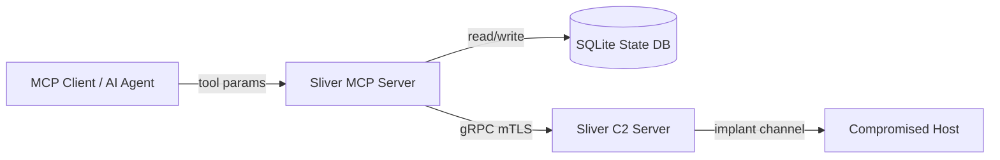

# Specification: Security Hardening

<!--
Primary engineering artifact for hardening the Sliver MCP server (`server.py`).
Tests (mold) and code (casting) must trace to SEC-1 through SEC-9.
Derived from brownfield audit (`docs/audit.md`) and current implementation review.
-->

## Metadata

| Field | Value |
|-------|-------|
| Module name | Security Hardening |
| Bounded context | Cross-cutting (MCP Server Operator Surface) |
| Version | 1.0.0-draft |
| Date | 2026-05-28 |
| Author | Codex Automata (security spec phase) |
| Status | Draft |
| Traces to audit | `docs/audit.md` — Critical Bugs 1–7 |
| Implementation target | `server.py` (~3821 lines, 82 MCP tools) |

## Overview

The Sliver MCP server exposes a large operator surface (gRPC to Sliver C2, remote command execution, engagement state persistence, OPSEC preflight, and compound playbooks). That surface runs on the operator workstation and drives actions on compromised hosts. Security failures therefore affect three parties: the operator machine (credential and state DB exposure), the engagement (wrong C2 endpoints, undetected EDR), and targets (command injection, detectable operator mistakes).

This specification defines mandatory security behaviors to remediate known defects in the current monolith: hardcoded C2 fallback, fail-open OPSEC scanning, inconsistent process-list handling, missing input validation, plaintext credential storage, shell command injection via interpolated parameters, naive argument splitting, absent audit logging, and dead code that obscures review. Each requirement is expressed with falsifiable preconditions, postconditions, and error conditions suitable for SDK validators and test molds.

## Scope

**Included:**

- Threat model for operator workstation, state database, target OPSEC, and command injection
- SEC-1 through SEC-9 behavioral requirements with pre/postconditions
- Input validation contracts for IP addresses, session IDs, ports, file paths, and shell arguments
- Credential encryption at rest for `credentials.secret`
- OPSEC scan fail-closed semantics and process-list normalization
- Audit trail for every MCP tool invocation
- Removal of unreachable code (`_FORMAT_MAP` and similar)

**Excluded (explicit):**

- Sliver server or implant security (upstream framework)
- Network transport encryption between MCP client and server (hosting/deployment concern)
- Authentication of MCP clients to this server (separate deployment spec)
- EDR signature database content and refresh policy (`edr_processes.json` curation)
- Full modularization of `server.py` into `src/` (architecture spec)
- Beacon interaction parity (documented in `docs/api-coverage.md`, not security)

## Threat Model

### Assets

| Asset | Location | Sensitivity |
|-------|----------|-------------|
| Engagement credentials | SQLite `credentials.secret` | Critical — passwords, hashes, keys |
| Operator Sliver config | `SLIVER_CONFIG` path | Critical — mTLS keys, operator identity |
| Session metadata | gRPC / tool responses | High — hostnames, users, paths |
| State DB file | `SLIVER_STATE_DB` | High — targets, creds, findings, access log |
| Remote execution channel | Sliver sessions | Critical — arbitrary command execution on targets |

### Threat Actors and Scenarios

1. **Operator machine compromise**  
   An attacker with filesystem or process access on the operator host can read `engagement_state.db`, environment variables, and MCP logs. **Impact:** full credential replay, engagement mapping, C2 infrastructure hints. **Mitigation:** SEC-5 (encryption at rest), SEC-8 (auditing with redaction), documented key management for `SLIVER_STATE_KEY`.

2. **Credential exposure via state DB**  
   MCP tools (`sliver_state_add_cred`, playbooks) persist secrets in plaintext today. **Impact:** offline extraction of all harvested creds. **Mitigation:** SEC-5.

3. **OPSEC detection on target**  
   High-risk tools run when EDR is present but scan failed silently, or scan never ran. **Impact:** detection, containment, lost access. **Mitigation:** SEC-2, SEC-3, consistent `_opsec_preflight` / `sliver_opsec_check` semantics.

4. **Command injection via tool parameters**  
   User-supplied values (e.g. `target_ip` in `sliver_lateral_check`) are embedded in PowerShell `-Command` strings without validation. **Impact:** arbitrary command execution on the compromised host as the implant user. **Mitigation:** SEC-4, SEC-6.

5. **Misdirected implant traffic**  
   Hardcoded C2 fallback when `ActiveC2` is empty sends migration shellcode to an unintended listener. **Impact:** lost session, wrong infrastructure, potential third-party exposure. **Mitigation:** SEC-1.

6. **Ambiguous or broken operator input**  
   `args.split()` breaks quoted arguments; inconsistent `ps()` handling yields false negatives on EDR scan. **Impact:** failed operations or false OPSEC clearance. **Mitigation:** SEC-3, SEC-7.

### Trust Boundaries



**Untrusted input:** All MCP tool parameters from the client. **Trusted:** Sliver gRPC responses after connection establishment; local config files explicitly configured by the operator.

## Domain Model

- **ValidatedInput:** Value object produced by SDK validators; immutable; carries `raw`, `normalized`, and `kind` (`ipv4`, `ipv6`, `session_id`, `port`, `path`, `shell_args`).
- **OpsecScanResult:** `{ detected: list[EdrHit], safe: bool, error: str | null }` — `safe` is false if EDR detected **or** scan could not complete.
- **AuditRecord:** Append-only log entry per tool invocation (SEC-8).
- **CredentialRecord:** Persisted row with `secret` stored as Fernet ciphertext blob (SEC-5).
- **ProcessList:** Normalized list of process descriptors `{ pid, executable, ... }` regardless of `ps()` wire shape (SEC-3).

## Behaviors

### SEC-1: No Hardcoded Network Addresses

- **Description:** Migration and any other C2 URL resolution must never substitute a compile-time or literal fallback address when session metadata lacks `ActiveC2`.
- **Preconditions:**
  - `sliver_migrate` is invoked with valid `session_id` and `pid`.
  - Session list is obtainable from the Sliver client.
- **Postconditions:**
  - If `sess_info.ActiveC2` is non-empty (after strip), `c2_url` equals that value (normalized URL with scheme if required by implant builder).
  - If `ActiveC2` is empty or whitespace-only, migration does **not** proceed; no implant config is sent to the target.
- **Error conditions:**
  - Return structured error via `_format_tool_error` with `error_type` appropriate (e.g. `ValueError` or dedicated `MissingActiveC2Error`).
  - Message must state that `ActiveC2` is unset on the session and instruct the operator to: (1) run `sliver_session_info` for the session, (2) verify listener/C2 configuration on the Sliver server, (3) re-establish or select a session with a known active C2 URL before migrating.
  - Must not contain any hardcoded IP, hostname, or URL in source or error paths.
- **Defect (FIXED):** Previously used a hardcoded fallback IP when `ActiveC2` was empty. Now fails closed with an explicit error guiding the operator.

### SEC-2: OPSEC Fail-Closed

- **Description:** `_opsec_scan_session` must treat any scan failure as **unsafe**, not safe. High-risk tool gating and operator-facing OPSEC tools must reflect uncertainty explicitly.
- **Preconditions:**
  - `session_id` passes session ID validation (SEC-4).
  - EDR signature config loaded (may be empty).
- **Postconditions:**
  - On successful scan with no signature matches: `{ detected: [], safe: true, error: null }`.
  - On successful scan with matches: `{ detected: [...], safe: false, error: null }`.
  - On any exception (session interact failure, `ps()` failure, parse failure, timeout): `{ detected: [], safe: false, error: "<exception message>" }`.
  - `_opsec_preflight`: when `scan["safe"]` is false and `error` is set, treat as blocked in `block` mode with message citing scan failure; in `warn` mode, return warning that includes `error` text.
  - `sliver_opsec_check`: when `error` is present, status must not be `CLEAR`; return `status: "ERROR"` or `status: "UNKNOWN"` with `safe: false` and the error detail (not equivalent to “no EDR detected”).
- **Error conditions:**
  - Must never return `safe: true` solely because an exception occurred.
  - `OPSEC_MODE=silent` may skip preflight messaging but must not change scan result semantics for `sliver_opsec_check`.
- **Current defect:** `except` branch returns `"safe": True` (~lines 2602–2603).

### SEC-3: Process List API Consistency

- **Description:** All code paths that consume `session.ps()` must use a single normalizer that accepts both return shapes produced by sliver-py / Sliver versions.
- **Preconditions:**
  - Active session handle from `_interact(session_id)`.
- **Postconditions:**
  - `_normalize_process_list(ps_result) -> list[ProcessEntry]` where each entry has at least `executable: str` (lowercased for matching), and optionally `pid`, `ppid`, `owner`, `architecture`.
  - **Shape A (iterable):** `ps_result` is a `list` or other iterable of process objects with attributes `Pid`, `Executable`, etc. — iterate directly (current `sliver_ps` behavior).
  - **Shape B (wrapper):** `ps_result` has attribute `Processes` (list, possibly empty) — use `getattr(ps_result, "Processes", []) or []` (current `_opsec_scan_session` / playbook behavior).
  - **Shape C (empty):** empty list, no processes — valid; OPSEC scan returns `safe: true` if no signatures configured or no matches.
  - `sliver_ps`, `_opsec_scan_session`, and playbooks calling `ps()` must all call `_normalize_process_list` (or equivalent SDK function); no duplicate divergent parsing logic.
- **Error conditions:**
  - If `ps_result` is neither iterable nor wrapper-with-Processes, raise or return scan error → SEC-2 fail-closed (`safe: false`, `error` describes unexpected type).
- **Current defect:** `sliver_ps` iterates `processes` directly; `_opsec_scan_session` uses `Processes` attribute — one path can succeed while the other silently sees zero processes.

### SEC-4: Input Validation

- **Description:** MCP tool entry points must validate parameters before gRPC calls, DB writes, or remote command construction. Validation lives in SDK `validators` module; server casts call validators and return `_format_tool_error` on failure.
- **Preconditions:** Tool invoked with string/numeric parameters from MCP client.
- **Postconditions:** Only validated values reach `_interact`, `_exec_on_session`, SQL, or shell string builders.

#### SEC-4.1 — IP addresses (`target_ip`, `callback_ip`, listener hosts, etc.)

| Rule | Requirement |
|------|-------------|
| Format | Must parse as IPv4 or IPv6 via `ipaddress.ip_address()` after strip |
| Characters | Reject if any of: `;`, `|`, `&`, `$`, `` ` ``, `'`, `"`, `\`, newline, carriage return, space (unless IPv6 bracketed form per stdlib) |
| Hostname | Hostnames are **rejected** for fields specified as IP (e.g. `target_ip`); use separate hostname validator if a tool requires FQDN later |
| Normalization | Store/use `str(ip_address)` canonical form |

#### SEC-4.2 — Session IDs (`session_id`)

| Rule | Requirement |
|------|-------------|
| Format | Non-empty string, length 8–64 |
| Charset | `[0-9a-fA-F]` only (hex UUID style used by Sliver) |
| Rejection | Fail fast before `_interact` with hint to run `sliver_sessions` |

#### SEC-4.3 — Port numbers

| Rule | Requirement |
|------|-------------|
| Type | Integer (coerce from string if needed) |
| Range | 1–65535 inclusive |
| Use | Listener tools, pivot checks referencing explicit ports |

#### SEC-4.4 — File paths (`path`, `remote_path`, `local_path`, `save_to`, `evidence_dir`, registry paths where user-supplied)

| Rule | Requirement |
|------|-------------|
| Traversal | Reject containing `..` as path segment (after normpath-style normalization for local paths) |
| Null bytes | Reject `\0` |
| Remote vs local | Local paths must resolve under allowed roots where tools impose constraints (e.g. evidence under `SLIVER_EVIDENCE_DIR`); document per-tool in casting |
| Windows | Reject mixed abuse: `....\\`, UNC injection via `\\` at start only when tool allows UNC — lateral tools use validated IP, not raw UNC strings from user |

#### SEC-4.5 — Command arguments (`args` string for execute/playbook helpers)

| Rule | Requirement |
|------|-------------|
| Parsing | Must use `shlex.split(args, posix=(os.name != 'nt'))` for Windows vs POSIX splitting rules |
| Metacharacters in **structured** tools | For tools that build argv lists (e.g. `_exec_on_session`), pass list form — do not embed user input in monolithic shell strings |
| exe field | Non-empty, max length 260, no newline; reject obvious injection patterns in `exe` alone (`&`, `|`, `;`) |

- **Error conditions:**
  - Validation failure returns JSON error payload: `{ "status": "error", "tool": "<name>", "error_type": "ValidationError", "message": "...", "field": "<param>" }`.
  - No side effects on target or DB when validation fails.

### SEC-5: Credential Encryption at Rest

- **Description:** All values written to `credentials.secret` must be encrypted before INSERT/UPDATE; reads decrypt for authorized tool output only.
- **Preconditions:**
  - `cryptography` package available (Fernet).
  - Key material resolved at process start.
- **Postconditions:**
  - **Key source (priority):** (1) `SLIVER_STATE_KEY` environment variable — URL-safe base64 32-byte key suitable for Fernet; (2) if unset, load from `{dirname(SLIVER_STATE_DB)}/.sliver_state_key` if file exists; (3) if missing, generate new Fernet key, write to `.sliver_state_key` with file mode `0600` (POSIX) or equivalent restricted ACL (Windows), log one-time warning to stderr.
  - `credentials.secret` column stores Fernet token (bytes or base64 text — pick one encoding, document in SDK; default: base64 UTF-8 string prefix `fernet:`).
  - `sliver_state_creds` and export paths decrypt for display; JSON export marks secrets as sensitive.
  - Migration path: on first DB open after upgrade, plaintext rows detected by absence of `fernet:` prefix are encrypted in place (single transaction).
- **Error conditions:**
  - If key missing and key file not creatable: refuse cred write operations with clear error; read-only listing may show `[encrypted—key unavailable]`.
  - Decryption failure: return error for that row, do not crash server; audit log records failure without leaking ciphertext.

### SEC-6: Command Injection Prevention

- **Description:** User-supplied values must not appear raw inside shell command strings built with f-strings or concatenation for PowerShell, `cmd.exe`, or `bash`.
- **Preconditions:** Tool accepts parameters used in remote execution (e.g. `target_ip`, `hostname` in scripts).
- **Postconditions:**
  - **Preferred:** Pass arguments as argv list to `session.execute(exe, arg_list)` — e.g. PowerShell: `["-Command", "Test-NetConnection", "-ComputerName", validated_ip, "-Port", "3389", ...]` or use `-ComputerName` parameter binding via separate args, not inline script with interpolation.
  - **When a single script string is unavoidable:** build with parameterized APIs (e.g. `powershell -Command` with encoded command from validated literals only, or fixed template with validated IP inserted only after `ip_address()` check and `shlex.quote` for the target shell).
  - `sliver_lateral_check`: `target_ip` validated by SEC-4.1 before any test row construction; PowerShell tests must not use f-strings embedding raw `target_ip`.
  - Audit all tools for f-string/command embedding (grep gate in CI); violations are casting defects.
- **Error conditions:** `ValidationError` before any `execute` call if parameter fails SEC-4.

### SEC-7: Argument Parsing (`shlex`)

- **Description:** String-based argument fields split with whitespace `.split()` are forbidden for operator-controlled input.
- **Preconditions:** Function receives `args: str` intended for `session.execute`.
- **Postconditions:**
  - `_exec_quiet`, `sliver_execute`, and any helper with signature `(exe, args: str)` use `shlex.split(args, posix=(os.name != 'nt'))` when `args` is non-empty.
  - Empty `args` yields `[]`.
  - Document in tool docstrings that quoting follows shell rules.
- **Error conditions:** `ValueError` from `shlex.split` (unclosed quotes) → validation error to caller, no execute.
- **Current defect:** `_exec_quiet` uses `args.split()` (~line 3560); `sliver_execute` same (~line 983).

### SEC-8: Audit Trail

- **Description:** Every registered MCP tool invocation emits one audit record after completion (success or failure).
- **Preconditions:** Tool handler wrapped by audit decorator or central dispatch hook.
- **Postconditions:**
  - Append to SQLite table `audit_log` (new) or structured JSONL file under `{dirname(SLIVER_STATE_DB)}/audit.jsonl` — **one** mechanism chosen at implementation; spec prefers DB table for queryability:

```sql
CREATE TABLE IF NOT EXISTS audit_log (
    id INTEGER PRIMARY KEY AUTOINCREMENT,
    timestamp TEXT NOT NULL,
    tool_name TEXT NOT NULL,
    session_id TEXT,
    parameters_json TEXT NOT NULL,
    success INTEGER NOT NULL,
    duration_ms INTEGER NOT NULL,
    error_summary TEXT
);
```

  - **Fields:**
    - `timestamp`: UTC ISO-8601
    - `tool_name`: MCP tool name
    - `session_id`: if parameter present, else null
    - `parameters_json`: JSON object of parameters with secrets redacted (`secret`, `password`, `token`, `key`, `hash` values → `"[REDACTED]"`)
    - `success`: 1 or 0
    - `duration_ms`: wall clock from entry to exit
    - `error_summary`: truncated message on failure, else null
  - Audit write must not raise uncaught exceptions to caller; log locally on audit failure.
- **Error conditions:** If audit DB unavailable, tool result still returned; stderr warning once per process.

### SEC-9: Dead Code Removal

- **Description:** Remove unreachable or unused symbols that increase review surface and confuse security analysis.
- **Preconditions:** Static analysis or coverage confirms zero references.
- **Postconditions:**
  - `_FORMAT_MAP` (~lines 45–50) removed, or wired correctly if implant format selection is intended — **removal preferred** unless `docs/api-coverage.md` mandates format tool in same release.
  - No other unused imports or maps retained solely for future use without a spec task.
  - `divergence-gate` / ruff F401 passes on `server.py` after removal.
- **Error conditions:** If format enum mapping is required before removal, block SEC-9 behind SDK extension approval — until then, removal is the default postcondition.

## Edge Cases

1. **`ActiveC2` present but malformed URL:** Migration fails with parse error; message guides operator to fix listener config — must not fall back to hardcoded IP (SEC-1).

2. **`ps()` returns wrapper with empty `Processes`:** Normalizer returns `[]`; OPSEC scan reports `safe: true` (no detections), not an error.

3. **`ps()` returns list of objects missing `Executable`:** Entry skipped or treated as empty string; must not crash scan; fail-closed only if entire call throws.

4. **IPv6 `target_ip` with brackets:** Validator accepts `2001:db8::1` and bracketed forms per `ipaddress`; PowerShell args use normalized unbracketed or properly quoted form.

5. **Session ID with uppercase hex:** Accepted; normalized to lowercase for comparisons if needed.

6. **Credential migration with wrong key:** Existing ciphertext unreadable; row flagged in admin export, not overwritten silently.

7. **`OPSEC_MODE=block` and scan error:** High-risk tool returns block message including scan error text; execution does not proceed.

8. **Parallel tool calls:** Audit records are independent; duration per invocation.

9. **Empty `args` for execute:** `arg_list = []` — no split call.

10. **`sliver_state_creds` filter parameters:** `domain` and `cred_type` validated as alphanumeric plus safe punctuation (no SQL injection — already parameterized; add length limits max 256).

## Failure Modes

| Scenario | Expected behavior |
|----------|-------------------|
| Sliver gRPC unavailable | Tool error via `_format_tool_error`; audit `success=0`; no SEC-1 fallback C2 |
| `ps()` timeout / session dead | OPSEC `safe=false`, `error` set; preflight blocks or warns per mode |
| Invalid `target_ip` | Validation error before network tests; no remote commands sent |
| `shlex.split` parse error | Validation error; no execute |
| Fernet key lost | Cred writes fail; reads cannot decrypt; operator docs describe key recovery |
| Audit table locked (SQLite busy) | Retry once; then stderr warning, tool result preserved |
| EDR config missing / corrupt | Scan proceeds with empty signatures → `safe=true` if `ps()` ok; load failure logged |
| Migration with valid C2 but migrate RPC fails | Error returned; audit records failure; no partial C2 override |

## Non-Functional Requirements

- **Security**
  - No hardcoded network endpoints in repository (enforced by divergence gate pattern for IPv4 literals in `server.py` except test fixtures if added later).
  - State key file permissions: owner-read only on POSIX; equivalent on Windows.
  - Dependencies: `cryptography>=41` for Fernet (pin in project requirements when casting).

- **Performance**
  - Validation overhead &lt; 1 ms per parameter at P95 on operator workstation.
  - Audit append &lt; 5 ms P95; async optional but must complete before tool response returns.

- **Operability**
  - One-time stderr notice when auto-generating `SLIVER_STATE_KEY` file.
  - Error messages actionable without reading source (hints in SEC-1, SEC-4).

- **Compliance with methodology**
  - SDK `validators.py` is the constraint surface for SEC-4–SEC-7.
  - No casting until SDK and molds exist for SEC behaviors (Codex Automata phase order).

## Interface Dependencies

**Depends on (consumer side):**

- Sliver Python client: `session.ps()`, `session.execute()`, `session.migrate()`, session list `ActiveC2` field
- Environment: `SLIVER_STATE_DB`, `SLIVER_STATE_KEY`, `SLIVER_OPSEC_MODE`
- `edr_processes.json` signature list

**Provides (producer side):**

- `sdk/validators.py` — validation contracts (SEC-4, SEC-6, SEC-7)
- `sdk/protocols.py` — `OpsecGuard`, `AuditLogger`, `CredentialStore` interfaces
- Future `src/` casting implementing behaviors in `server.py`

## Open Questions

1. **Audit storage:** SQLite `audit_log` table vs JSONL only — which is preferred for operator forensics? *Blocks:* final schema migration in SEC-8 casting. *Recommendation:* SQLite table co-located with state DB.

2. **Hostname support in lateral movement:** Should a future tool allow FQDN with DNS validation separate from `target_ip`? *Blocks:* none for current SEC-4.1 (IP-only).

3. **Credential plaintext migration:** In-place encrypt on read vs batch migration tool — *Recommendation:* in-place on `_get_state_db()` init with backup prompt in operator docs.

4. **`_FORMAT_MAP` removal vs wiring:** Confirm no planned `sliver_generate` format parameter in v1.1. *If yes:* wire map; else remove per SEC-9.

[Resolve audit storage and FORMAT_MAP before finalizing molds for v1.0.0.]

## Revision History

| Version | Date | Author | Summary |
|---------|------|--------|---------|
| 1.0.0-draft | 2026-05-28 | Codex Automata | Initial security hardening spec from brownfield audit and `server.py` review (SEC-1–SEC-9) |
